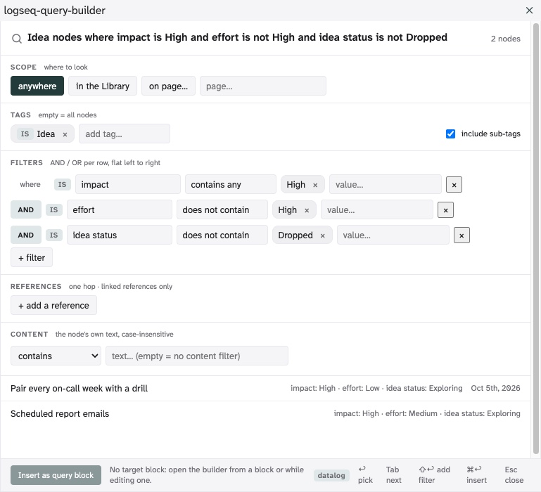

# Query Builder

Build a Logseq DB query visually — choose where to look, pick tags, add typed property filters,
optionally search node text — see the matching nodes as you go, jump to one, or insert the query
into a page as a named, live query node. No Datalog written by hand.



> **Status: first implementation complete, used on a scratch graph only.** State and next steps:
> [`TASKS.md`](./TASKS.md). Loading it for testing: [`INSTALL-DEV.md`](./INSTALL-DEV.md).
> Design record: [`PLAN.md`](./PLAN.md), the spec and prototype in `logseq-query-builder-handoff/`,
> live findings in [`docs/probes.md`](./docs/probes.md). Changes: [`CHANGELOG.md`](./CHANGELOG.md).

## Install

Not on the marketplace yet. Download `logseq-query-builder.zip` from the
[latest release](https://github.com/hdansou/logseq-query-builder/releases), unzip it, turn on
*Developer mode* in Logseq's settings (Advanced), then *Plugins → Load unpacked plugin* and pick the
unzipped folder. The plugin needs a DB graph; it does nothing in a file graph.

## Using it

Open the builder with **⌘⇧F** (also "Query Builder: open" in the command palette), or type
**/Query Builder** inside a block. While the plugin is enabled, ⌘⇧F
takes over Logseq's toggle-favorite shortcut; rebind either in Logseq's keymap settings. The panel floats: drag it by its title bar, resize it from the
corner, click the graph behind it. It remembers where you left it and stays inside the window if
that was a bigger screen.

| Zone | What it does |
|---|---|
| **Scope** | Where to look: *anywhere* (default), *in the Library*, or *on page…*. See [Scopes](#scopes). |
| **Name** | The query's title once inserted. Prefilled with a plain-English reading of your filters; edit or replace it. |
| **Tags** | Autocomplete over your graph's tags, most-used first. Several tags combine with AND / OR; each can be NOT. "any tag" means your tagged nodes (tag and property pages, built-ins and property values do not count); NOT any tag means untagged. The list opens as you type or with ↓. *Include sub-tags* (on by default) also matches tags that extend the chosen one. |
| **Filters** | One row per property: property → operator → value. Operators follow the property's type (text, number, URL, node, asset, date, date-time, checkbox). Rows combine with AND / OR left to right, each can be NOT. Values are picked from what the graph actually holds, with counts; text and numbers also accept free entry; dates accept `today`, `tomorrow`, `yesterday`, `±Nd/w/m/y` or `YYYY-MM-DD`, typed or picked from the calendar button beside the field. |
| **References** | One row per relationship: *links to*, *is linked from*, *ancestor links to*, or *on page under*, then a target: one node, or *any \<tag\>* (sub-tags included) optionally narrowed by a name fragment and by property conditions. Rows combine with AND / OR, each can be NOT. See [References](#references). |
| **Content** | Search the node's own text: contains, does not contain, starts with, or a regular expression. |
| **Results** | The first 10 matches with the values you filtered on and the page they live on; *Show more* reveals the rest. Click or select one to jump to it — the builder stays open. |

The **datalog** toggle in the footer shows what would be inserted. New to queries? Start with the
[cheatsheet](docs/cheatsheet.md).

### Scopes

A scope narrows the whole query before tags and filters apply. It counts as a filter on its own,
so a scope with only NOT filters still runs.

| Scope | Returns | Typical use |
|---|---|---|
| **anywhere** | every node in the graph | the default |
| **in the Library** | pages inside Logseq's Library page (any depth) and the blocks on them | "tasks in my library pages", "library pages without a description" |
| **on page…** | the blocks that live on the page you pick | "tasks on my Sprint page" |

*In the Library* is the same question as a reference row *on page under · Library*, offered as one
click. Relationships to other nodes are reference rows, below.

### References

A reference row reads `that <direction> <target>`. Direction is the operator; the target is one node
(pages, journals, blocks) or every node carrying a tag, with sub-tags included like the tag selector,
optionally narrowed with *named like…* to titles containing a fragment and with *+ condition on
the target*: property rows evaluated on the target set, with the same controls as a filter row, so
*is linked from any Task whose Status is Todo* reads exactly that. One hop: a task linking to a
project that links to a client does not *link to* the client. Linked references only: a name typed
without a link is not found.

| Direction | Matches nodes that… | Typical use |
|---|---|---|
| **links to** | link to the target in their text or through a node property (an assignee, a `part of`) | "tasks that link to Project Iris", "notes that link to any journal" |
| **is linked from** | are linked from the target: from the node itself or, for a page, from any block on it | pick your `Book` page, add the tag `artist`: every artist mentioned in that book. This is the backlink question |
| **ancestor links to** | link to the target themselves or sit under a block that does, at any depth | tasks indented under a `[[Project Iris]]` line in a journal, which carry no link of their own |
| **on page under** | live on the target page or on any page beneath it in the page tree | "tasks under Acme Corp" when Acme holds Finance and Engineering pages |

Logseq records the tags a block carries and the properties it uses as references too. The builder
leaves those out where they would read as links: a tag's own objects are not "linked to" the tag,
and a page does not "link to" the properties it uses.

### Keys

`↩` pick · `Tab` next control · `⇧↩` add a filter · `⌘↩` insert · `Esc` close a list, then the panel

### Insert

*Insert* writes a `#Query` node: from the shortcut, a new sibling after the block you were editing;
from the slash command, into that block. The node renders as a live query table like a hand-written
one. Relative dates are stored as expressions, so the query stays current. Pressing ⌘⇧F while
editing that block reopens the builder with its filters (the command palette opens a fresh builder:
it takes focus from the editor before the command runs, so it cannot see which block you were in).

## Privacy

The plugin reads your graph through the Logseq plugin API to fill its pickers and preview results.
It writes only what you ask it to: the target block (tag, query text, title) and one hidden
property on that block, `query-builder-state`, holding your filters as JSON so the block reopens in
the builder with the same chips. It is hidden by default; Logseq's per-block "Show hidden
properties" toggle reveals it. Nothing is sent anywhere; there is no network
access, telemetry or storage outside your graph.

## Limits (first implementation)

Flat composition only (no parenthesised groups), a list view (no table), relative dates limited to
what the host resolves natively (no "start of week"), no sorting. See `TASKS.md` for what comes
later.

## Development

```bash
npm install
npm run dev        # vite on :8291 — see INSTALL-DEV.md to load it in the web app
npm test           # vitest
npm run typecheck
npm run build      # dist/
```
